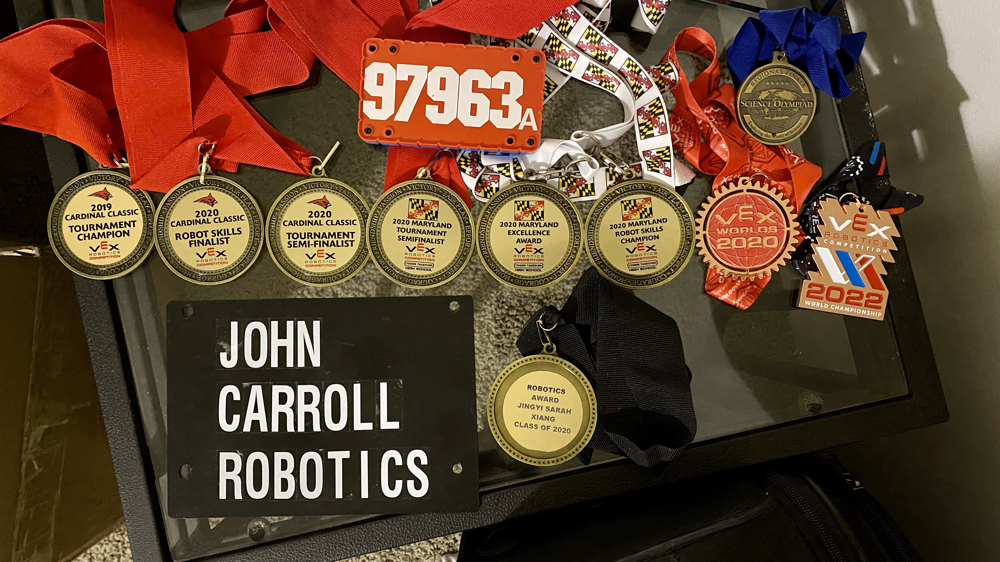
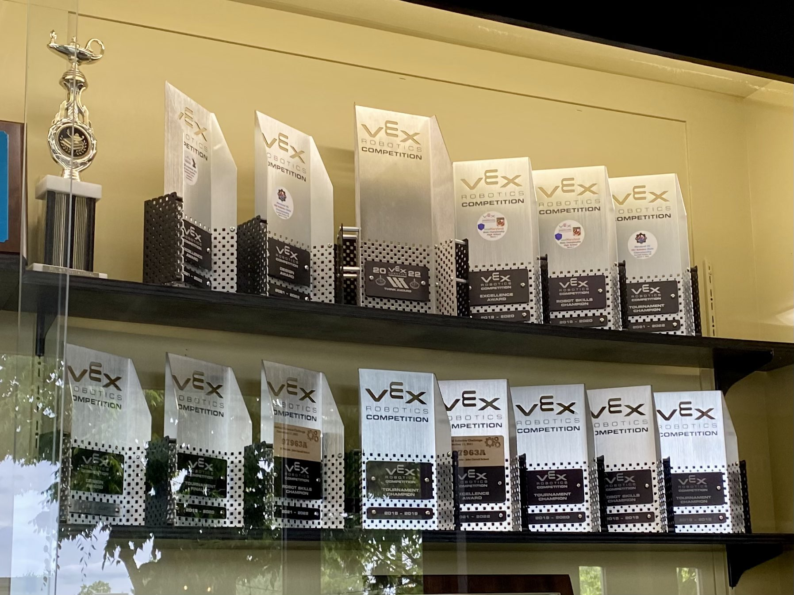

I competed in the [VEX Robotics Competition](https://www.vexrobotics.com/competition) from 2018 - 2021, an extracurricular activity that eventually sparked my interest in robotics. 
<!-- My team's stats can be found [here](https://vexdb.io/teams/view/97963A?t=skills).  -->
Below are some competition robots designed and built by me.

<!-- [2019 - 2020 (Tower Takeover)](#2019-2020) \\
[2020 - 2021 (Change Up)](#2020-2021) -->

###### The CAD models might take a minute to fully load.
&nbsp;

<h4 id="2019-2020"><strong>2019 - 2020 (Tower Takeover)</strong></h4>
---
**Game Objective:** Picking up and stacking plastic cubes \\
**Robot Videos:** [Playlist](https://www.youtube.com/watch?v=2yH0XbTgVOY&list=PLOVSIsYOyOF3BGpvA9BS9q3m-NSgKIeYY&index=1) \\
**Global Ranking:** 18th (combined); 3rd (programming)

**Robot CAD Model:**
<iframe src="https://illinois8323.autodesk360.com/shares/public/SH286ddQT78850c0d8a49324b65e27dfceb0?mode=embed" width="640" height="480" allowfullscreen="true" webkitallowfullscreen="true" mozallowfullscreen="true"  frameborder="0"></iframe>

&nbsp;

<h4 id="2020-2021"><strong>2020 - 2021 (Change Up)</strong></h4>
---
**Game Objective:** Picking up plastic spheres and dropping them into cylindrical baskets \\
**Robot Videos:** [Iteration 1 Playlist](https://www.youtube.com/watch?v=lbfCjw0BKeE&list=PLOVSIsYOyOF0WgNdBguiLier7NUoR-k7x&index=1), [Iteration 2 Playlist](https://www.youtube.com/watch?v=Oa5fJqwaVGs&list=PLOVSIsYOyOF2BbGYWc2-0hXRldbet2tI_&index=1) \\
**Global Ranking:** 5th (combined)

I built both robots below inside my dorm room during freshman year of college.

**Iteration 1 Robot CAD Model:**
<iframe src="https://illinois8323.autodesk360.com/shares/public/SH286ddQT78850c0d8a4b99f956b8260ddb7?mode=embed" width="640" height="480" allowfullscreen="true" webkitallowfullscreen="true" mozallowfullscreen="true"  frameborder="0"></iframe>

\\
**Iteration 2 Robot CAD Model:**
<iframe src="https://illinois8323.autodesk360.com/shares/public/SH286ddQT78850c0d8a435ba6543faa238d6?mode=embed" width="640" height="480" allowfullscreen="true" webkitallowfullscreen="true" mozallowfullscreen="true"  frameborder="0"></iframe>

&nbsp;

I had a good competition career, though I wish it could have been a little bit longer.

 

 
